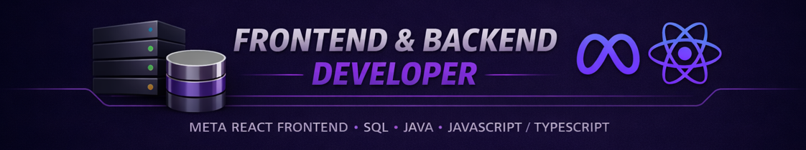

  

  # Rubén | Full Stack Developer
  **Desarrollo Frontend, Backend Empresarial e Integración de IA con Google Antigravity**

  

    
    
    
    
  

---

### 👨‍💻 Sobre mí

Soy un desarrollador Full Stack con más de **4 años de experiencia** diseñando e implementando aplicaciones web de extremo a extremo.

* **Frontend:** Certificado profesionalmente por **Meta en React**. Especializado en interfaces dinámicas, optimizadas para rendimiento (Lighthouse), accesibilidad y SEO utilizando **React**, **Next.js** y **TypeScript**.
* **Backend:** Desarrollo de servicios robustos y escalables con **NestJS**, **Node.js** y **Java Spring Boot**, implementando autenticación segura (OAuth 2.0, JWT), arquitectura limpia y principios **SOLID**.
* **Bases de Datos:** Modelado relacional y no relacional con **SQL Server**, **MySQL** y **MongoDB**, optimización de consultas complejas, procedimientos almacenados y transacciones bajo principios **ACID**.
* **Desarrollo Acelerado con IA (Google Antigravity):** Incorporación activa de agentes autónomos y herramientas de inteligencia artificial en el flujo de trabajo para optimizar la arquitectura, refactorización de código y cobertura de pruebas.

---

### 💻 🚀 Proyectos Destacados

* **Good Recipes** | [Repositorio](https://github.com/RubDev476/Good-recipes) • [Demo en vivo](https://good-recipes-vert.vercel.app/)  
  *Plataforma interactiva de recetas con filtrado dinámico y búsqueda en tiempo real.*  

* **Group-4** | [Repositorio](https://github.com/RubDev476/Group-4) • [Demo en vivo](https://group-4-rho.vercel.app/)  
  *Comunidad y red social con hilos de conversación, votación y actualización de contenido dinámico.*  

* **Next Ride** | [Repositorio](https://github.com/RubDev476/RE-Cars) • [Demo en vivo](https://re-cars.vercel.app/)  
  *Catálogo y portal interactivo para la comercialización de vehículos seminuevos con filtros avanzados.*  

* **Next Ride (API Backend)** | [Repositorio](https://github.com/RubDev476/NextRide-API)  
  *API RESTful para catálogo de autos para sitio web de venta de autos.*  

* **Next Loot** | [Repositorio](https://github.com/RubDev476/General-services) • [Demo en vivo](https://g-services.vercel.app/)  
  *Hardware y gaming, marketplace para vender o comprar componentes de gaming o pc.*  
---

### 🛠️ Habilidades Técnicas

#### 🤖 Inteligencia Artificial & Flujos Agénticos
* **Google Antigravity:** Desarrollo asistido por agentes autónomos, orquestación de subagentes para tareas complejas de refactorización, scaffolding inteligente de módulos y aceleración del ciclo de vida del software.
* **Herramientas de IA:** Microsoft Copilot, ingeniería de contexto, generación automatizada de pruebas y análisis estático de código asistido por LLMs.

#### 🎨 Frontend
* **Core:** React, Next.js, TypeScript, JavaScript (ES6+), HTML5 Semántico.
* **Gestión de Estado:** Redux Toolkit, Context API, Zustand, Custom Hooks.
* **Estilos & UI:** Tailwind CSS, Sass, Styled Components, Bootstrap, Material UI, Figma (maquetado y mockups).
* **Calidad & Rendimiento:** Mobile First, Core Web Vitals, Lighthouse, Accesibilidad Web.

#### ⚙️ Backend & APIs
* **Lenguajes & Frameworks:** JavaScript/TypeScript (Node.js, NestJS, Express), Java (Spring Boot, Spring Security, Spring Web).
* **Persistencia & ORM:** JPA, Hibernate, JDBC, Lombok, TypeORM.
* **Seguridad & Arquitectura:** RESTful APIs, Autenticación JWT, OAuth 2.0, DTOs, Patrón MVC, Microservicios.
* **Documentación & Nube:** Swagger, Postman, Cloudinary, Firebase Storage.

#### 🗄️ Bases de Datos
* **Relacionales & NoSQL:** SQL Server, MySQL, MongoDB, Firebase Firestore.
* **Modelado & Rendimiento:** Diseño y normalización de esquemas, Joins, CTEs, subqueries, Stored Procedures, Views y transacciones con principios ACID.

#### 🧪 Testing & Calidad de Código
* **Pruebas:** Jest, React Testing Library, Vitest, JUnit, Mockito.
* **Estándares:** Principios SOLID, Clean Code, POO, DRY, KISS.

#### 🔧 Herramientas & DevOps
* Git, GitHub, Docker, VS Code, IntelliJ IDEA, WebStorm.

---

### 📜 Certificaciones

* **Meta Certified React Developer** — Meta Professional Certificate

---

### 📬 Contacto

* **LinkedIn:** [linkedin.com/in/rubdev476](https://www.linkedin.com/in/rubdev476/)
* **Email:** [rubdeveloper476@gmail.com](mailto:rubdeveloper476@gmail.com)
* **GitHub:** [github.com/RubDev476](https://github.com/RubDev476)
